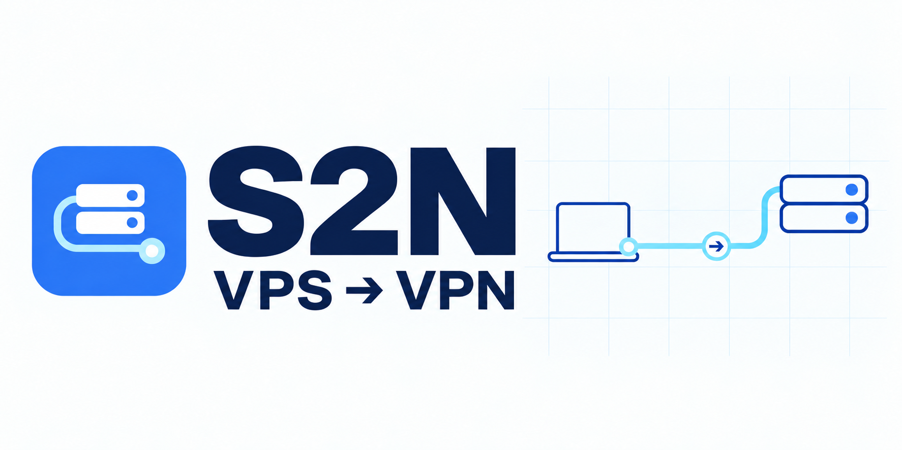

[**简体中文**](README.md) · [English](README.en.md)<br>


# S2N Connect

**给你的 VPS 增加 VPN 功能。**

这就是 S2N 的命名含义。S2N Connect 提供桌面端和 Android 客户端。桌面端可在自有 VPS 上部署 Xray 的 **VLESS + REALITY** 服务，并在本机使用 **sing-box TUN** 分流；Android 端导入桌面端导出的配置，连接已经部署的 VPS。你需要自备 VPS。

[下载 Beta 版本](https://github.com/cavwic/s2n-connect/releases) · [更新记录](CHANGELOG.md) · [报告问题](https://github.com/cavwic/s2n-connect/issues)

## 平台

| 客户端 | 架构 | 发布包 |
| --- | --- | --- |
| Windows 10 / 11 | x64、ARM64 | `.zip` |
| macOS 13+ | Intel、Apple silicon | `.tar.gz` |
| Linux 桌面（包括 Ubuntu） | x64、ARM64 | `.tar.gz` |
| Android 8.0+ | ARM64、x86_64 | universal `.apk` |

发布包含六个桌面目标和一个 Android 通用 APK。编译、打包和模拟器界面测试通过不代表各系统的 VPS 联网与 TUN 已完成实机验证，具体限制见下文。

**VPS：** 当前 Beta 的部署目标为带 systemd 的 Ubuntu / Debian，需通过 root 用户进行 SSH 连接。

## 桌面端主要功能

- **部署与安装：** 可一键部署本机 sing-box 和 VPS 服务，也可分别操作。自动识别系统、架构；安装目录由你选择，下载包通过 SHA-256 校验后解压，验证可执行文件后保存路径，并清理临时下载文件。
- **SSH 连接：** 自定义 SSH 用户和端口，从任意本地目录选择私钥并按内容验证格式；首次连接需核对服务器指纹，后续指纹变化会拒绝连接。私钥路径仅在连接成功后保存，私钥口令不落盘。
- **发现已有安装：** 从保存设置、运行进程、PATH 和常用位置查找 sing-box，并更新操作按钮状态。
- **按需分流：** 程序名与域名后缀规则独立生效；清空规则不会变成无条件代理。规则模式默认直连，全局模式将公网流量交给 VPS；局域网、私有地址和 VPS 地址保持直连。
- **DNS：** 公网域名通过 VPS 使用远端 DoH，本地名称和反向查询使用本地 DNS。
- **状态与控制：** 先判断 sing-box 进程，再经受管理的代理检测 Google 连通性；连接与停止按钮按实际进程状态更新。出口 IP 查询失败不会否定已确认的连接。
- **桌面偏好：** 系统、浅色和深色主题可即时切换并保存；中文系统使用中文，其余系统使用英文；支持系统托盘菜单的环境可从托盘显示、连接、停止和退出。
- **启动与连接：** 可在登录后延迟约 60 秒启动；自动连接需先成功连接一次，并检查网络、DNS、VPS 端口与本地安装是否就绪。

安装校验优先使用官方发布的 SHA-256 校验和文件；发布未提供该文件时，使用 GitHub 发布资产的 SHA-256 digest。校验值缺失、无效或不匹配都会停止安装，不会跳过验证。

## 使用前准备

- 自备 Ubuntu / Debian VPS、root SSH 私钥，以及可用的 SSH 端口；服务端使用 **TCP 443**，请确保该端口可用，并在云防火墙和系统防火墙中放行。
- 建议先在干净 VPS 上使用。部署会安装 Xray、写入服务配置并启用服务；已有 Xray 配置或其他服务时，请先备份并检查冲突。
- 本机与 VPS 需要能访问相关下载源。本机启动 TUN 时需要管理员授权；Linux 使用 `pkexec`，macOS 使用系统管理员提示。
- 下载与你的系统和架构匹配的发布包，完整解压后运行 `S2N.exe`（Windows）或 `S2N`（macOS / Linux）。发布包自带 .NET 运行时。

## 快速使用

1. 填写 VPS 地址、SSH 用户和端口，选择 SSH 私钥；加密私钥需填写本次使用的口令。
2. 点击“测试 VPS”，通过供应商控制台或其他可信渠道核对首次显示的 SSH 服务器指纹。
3. 点击“一键部署”，选择本地 sing-box 安装目录并等待完成。也可使用“选择并安装”和“仅部署 VPS”分别操作。
4. 在“规则管理”中设置程序名和域名后缀，按需启用全局模式；点击“连接”并完成管理员授权，等待连通性检测。
5. 点击“停止”断开连接，使用“退出”结束程序。支持托盘的环境中，关闭窗口或最小化可能只会隐藏主窗口。

首次成功连接后，可再按需开启自动连接和登录启动。自动连接不会代填加密 SSH 私钥口令；日常连接使用已部署的 VPS 配置。

## Android 使用

1. 在桌面端部署或配置好 VPS，使用移动端配置导出功能保存连接配置。导出文件含连接凭据，请通过可信方式传到自己的手机。
2. 安装发布中的 `android-universal.apk`，导入该配置。Android 端连接现有 VPS，不执行 SSH 部署。
3. 点击连接并确认 Android 的 VPN 授权；停止时使用应用中的停止按钮。Android 同时只允许一个 VPN 应用接管流量。

APK 同时包含 ARM64 和 x86_64 的原生核心，使用项目持久签名密钥签名。模拟器测试覆盖界面、VPN 授权及仅直连测试配置的真实 TUN 启停，不连接 VPS，也不验证代理联网。

## 构建与验证

开发构建使用 **.NET 10 SDK** 和 **Avalonia 12**，应用目标框架为 `net8.0`。发布包为 self-contained，终端用户无需另装 .NET。

```bash
dotnet restore
dotnet build -c Release
dotnet run --project tests/S2N.ConfigChecks/S2N.ConfigChecks.csproj -c Release
dotnet run --project tests/S2N.ReleaseChecks/S2N.ReleaseChecks.csproj -c Release
```

例如发布 Windows x64：

```bash
dotnet publish src/S2N.App/S2N.App.csproj \
  -c Release \
  -r win-x64 \
  --self-contained true \
  -o artifacts/win-x64
```

配置回归检查使用独立临时目录，验证分流、DNS 和设置中的关键约束，不连接 VPS、不启动实际 TUN。其他发布目标为 `win-arm64`、`osx-x64`、`osx-arm64`、`linux-x64`、`linux-arm64`。

### Android 构建

`android/` 是原生 Kotlin 项目，使用 JDK 17、Gradle 9.6、AGP 9.4、SDK 36 和 NDK 28.0.13004108。使用 Go 1.26.8 从固定的官方 sing-box 源码构建 libbox，再构建 APK：

```bash
bash android/scripts/build-libbox.sh
cd android
bash ./gradlew :app:lintDebug :app:testDebugUnitTest :app:assembleDebug
```

正式 APK 需要私有签名配置，步骤见[发布指南](GITHUB_PUBLISHING.md)。固定核心版本和许可见[第三方说明](THIRD_PARTY_NOTICES.md)。

## Beta 限制与发布校验

- 当前为 Beta。真实 VPS 连接、局域网访问、停止后的路由与 DNS 恢复，仍需按[发布检查清单](RELEASE_CHECKLIST.md)在各平台实测；不要将构建通过视为联网功能验证通过。
- Windows 提权是当前主要实现；macOS 的 `osascript` 与 Linux 的 `pkexec` 路径仍需更多实机验证。其他 VPS 发行版尚未纳入部署支持，IPv6 行为也需单独验证。
- Android APK 使用项目发布密钥签名；桌面发布包未签名，macOS 包未公证，系统可能显示信任提示。SHA-256 和 GitHub 溯源证明不替代平台签名，详见[签名说明](SIGNING.md)。
- GitHub Actions 等待六个桌面包、Android APK 和 Android 模拟器检查全部成功并验证 SHA-256 后发布；Beta 标签标为预发布。CodeQL 与 artifact attestations 受仓库可用功能限制，运行或跳过状态以工作流摘要为准。
- 连通性与 IP 信息查询会访问 Google、Cloudflare 和 IP 查询服务；配置文件含客户端连接凭据，请勿公开上传。私钥内容不保存到应用设置中，具体见[安全说明](SECURITY.md)。

## 许可与项目文档

桌面端使用 [MIT 许可证](LICENSE)。Android 应用与 libbox 的组合按 **GPL-3.0-or-later** 分发；该许可不改变桌面端的 MIT 许可。sing-box、Xray 及其他依赖遵循各自上游许可证，参见[第三方说明](THIRD_PARTY_NOTICES.md)。

[架构](ARCHITECTURE.md) · [参与贡献](CONTRIBUTING.md) · [GitHub 发布指南](GITHUB_PUBLISHING.md) · [更新记录](CHANGELOG.md)

<!-- Reserved promotion slots; hidden until content is ready.
<table width="100%">
  <tr>
    <th width="50%">VPS 推荐</th>
    <th width="50%">个人推广</th>
  </tr>
  <tr>
    <td><br><br><br></td>
    <td><br><br><br></td>
  </tr>
</table>
-->
